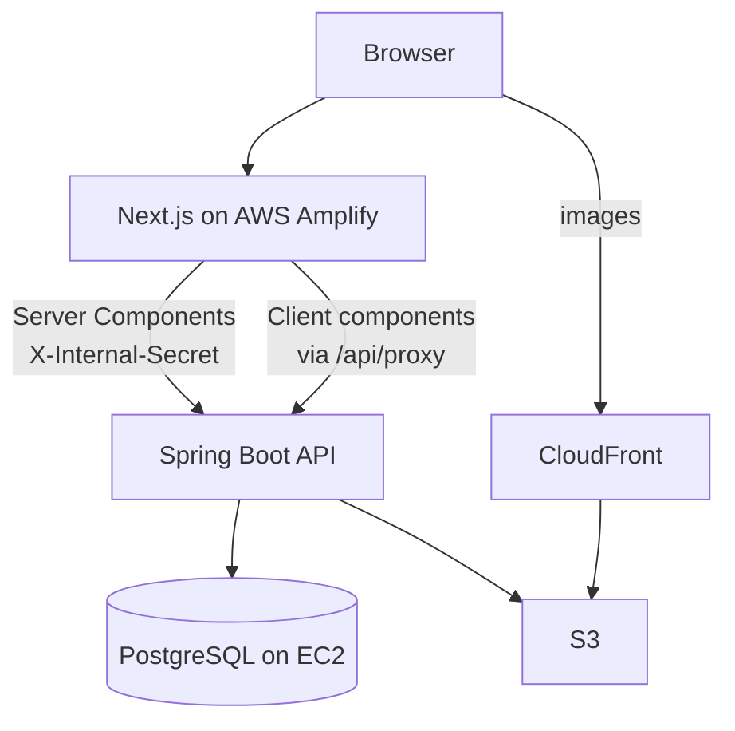

# edens.zac

[](https://nextjs.org/)
[](https://react.dev/)
[](https://www.typescriptlang.org/)
[](https://sass-lang.com/)

The frontend for [zacedens.com](https://zacedens.com), a photography portfolio. It serves public collections, private client galleries and blog entries, plus the admin tools that manage them. The Spring Boot API lives in [edens.zac.backend](https://github.com/themancalledzac/edens.zac.backend).

---

## Tech stack

| Layer    | Technology                                        |
| -------- | ------------------------------------------------- |
| Frontend | Next.js 16 (App Router), React 19, TypeScript 5.9 |
| Styling  | SCSS Modules                                      |
| Backend  | Spring Boot REST API, PostgreSQL on EC2           |
| Images   | AWS S3 behind CloudFront                          |
| Hosting  | AWS Amplify                                       |
| Testing  | Jest, React Testing Library, Playwright           |
| Linting  | ESLint 9 (flat config), Stylelint, Prettier       |

---

## Features

Public site:

- Collections that hold any mix of images, GIFs, text blocks and other collections.
- A row layout that gives higher-rated photos more space.
- A photo-size control (large, medium, small) on collection pages.
- Tag and location pages, search, and an explore page.
- Parallax collection cards.

Accounts and client galleries:

- Sign-in with password or passkey. New users join through invite links.
- Per-gallery roles: `GENERAL` can view, `CLIENT` can also download and select favorites, `COLLABORATOR` can also edit curation.
- Password-gated client galleries, share links, and full-resolution downloads.
- A personal space at `/user` with the user's collections, images and saved photos. Users can follow collections.

Admin:

- An admin hub at `/admin` with user and role management, plus a page for messages sent through the contact form.
- A collection editor, an all-images browser and a bulk metadata editor.
- Image and GIF upload, cover selection and content ordering.

---

## Getting started

### Prerequisites

- Node.js 22 or later. `.nvmrc` pins 24.
- npm 9 or later.
- A running backend on `localhost:8080`. See the [backend README](https://github.com/themancalledzac/edens.zac.backend).

### Install

```bash
git clone https://github.com/themancalledzac/edens.zac.git
cd edens.zac
npm install
```

### Environment variables

Create `.env.local` in the project root:

```bash
API_URL=http://localhost:8080
NEXT_PUBLIC_APP_URL=http://localhost:3000
NEXT_PUBLIC_ENV=local
INTERNAL_API_SECRET=
```

| Variable              | Purpose                                                                |
| --------------------- | ---------------------------------------------------------------------- |
| `API_URL`             | Backend base URL. Read only on the server.                             |
| `INTERNAL_API_SECRET` | Sent to the backend as `X-Internal-Secret` on server-side requests.    |
| `NEXT_PUBLIC_APP_URL` | The site's own origin.                                                 |
| `NEXT_PUBLIC_ENV`     | `local` turns on the local admin bypass. Never set it in a deployment. |

### Scripts

| Command              | What it does                              |
| -------------------- | ----------------------------------------- |
| `npm run dev`        | Dev server on `http://localhost:3000`     |
| `npm run build`      | Production build                          |
| `npm test`           | Jest unit and component tests             |
| `npm run test:watch` | Jest in watch mode                        |
| `npm run test:e2e`   | Playwright tests in `tests/e2e/`          |
| `npm run type-check` | `tsc --noEmit`                            |
| `npm run lint`       | ESLint and Stylelint                      |
| `npm run lint:fix`   | ESLint and Stylelint with autofix         |
| `npm run format`     | Prettier over the whole tree              |
| `npm run analyze`    | Production build with the bundle analyzer |

### Working on admin pages

In local dev, `/admin` and the other admin routes render without a login. The backend's dev profile also answers anonymous admin requests as the bootstrap admin, but only from loopback addresses and any listed in `DEV_LOCAL_ADMIN_EXTRA_ADDRESSES`. If the backend runs in Docker, either set that variable to the Docker gateway address or sign in at `http://localhost:3000/login` with `ADMIN_BOOTSTRAP_EMAIL` and `ADMIN_BOOTSTRAP_PASSWORD`.

> **The local backend writes to production.** Local development reaches the database through an SSH tunnel to the production EC2 instance. Every admin change you make on localhost edits live data.

---

## Architecture



Server Components are the default. Pages fetch on the server, calling the backend directly with `INTERNAL_API_SECRET`. Client components are used where the page needs interaction: modals, forms, the editor, parallax and the fullscreen viewer. They call the backend through `/api/proxy`, which forwards the request with the user's session cookie and checks the path and origin.

Only `app/lib/api/serverBackend.ts` and the proxy route read `API_URL` and `INTERNAL_API_SECRET`, so neither reaches a client bundle.

Reads in `app/lib/api/` use Next.js cache tags (`collection-<slug>`, `collections-index` and others). Admin changes clear them through `/api/revalidate`.

### Hosting and deploys

Production runs as a Next.js server on AWS Amplify, which puts its own CloudFront distribution in front. Merging to `main` builds and deploys in about fifteen minutes. The build config lives in the Amplify console, not this repo.

`main` is protected. The `Type check, lint, test` GitHub check must pass before a merge, and nobody can push to `main` directly.

Images come from a separate CloudFront distribution over S3, pinned in `next.config.js`.

---

## Content model

A collection is a named, ordered list of content. Content is images, GIFs, text blocks, or references to other collections. Collections have no type field. A collection is defined by what it holds.

Two stored flags mark the only kinds the system treats differently:

- `isClient`: a private client delivery, gated behind a per-collection password.
- `isBlog`: a dated entry, shown and sorted by date.

Both default to false, which is an ordinary collection. The backend rejects a collection with both set.

Two other properties are derived, not stored:

- A collection is a parent when it holds at least one collection reference. The server computes this over the whole content graph and returns `hasChildren` and `childCollectionIds`.
- The home page is the collection with slug `home`.

A collection can sit inside several parents, so the content graph is a DAG, not a tree.

---

## Layout

Each image gets a prominence value from its 0 to 5 star rating. Rating does not depend on orientation: a 5-star portrait and a 5-star landscape have the same rating. Very wide or very tall images get extra weight. Collection cards count as 4 stars and text blocks as 1.

The layout fills each row up to a width budget, then splits the row into a binary tree of horizontal and vertical groups (`BoxTree`). It scores every arrangement on aspect ratio and balance and keeps the best one. A photo gets a row to itself only when it is both highly rated and wide enough to need the space.

Rows are measured in abstract slots: 8 on desktop and 3 on mobile. The photo-size control changes how many photos fit in a row.

The full write-up is in [`app/utils/rowCombination.md`](app/utils/rowCombination.md).

---

## Project structure

```
app/
  (site)/                     Site pages that share the site header
    page.tsx                    Home
    collections/, explore/, search/
    login/, user/               Sign-in and the user's own space
    s/[token]/, invite/[token]/ Share links and invites
    (admin)/                    Admin-only routes
      admin/                      Admin hub and user detail pages
      all-images/, all-client-galleries/, comments/, metadata/
      collection/manage/          Collection editor
  [slug]/                     Collection pages
  tag/[slug]/, location/[slug]/
  api/                        proxy, revalidate, csp-report, client-errors
  components/                 UI components
  hooks/                      Shared hooks (useViewport, useParallax, useFetchMe, ...)
  lib/                        api/ (typed backend client), actions/, storage/
  types/, utils/, constants/, styles/
proxy.ts                      Request proxy for admin and auth routing
tests/                        Jest tests that mirror app/; e2e/ holds Playwright specs
docs/                         backlog.md, decisions.md, browser-diagnostics.md
```

Open work is tracked in [`docs/backlog.md`](docs/backlog.md) and past decisions in [`docs/decisions.md`](docs/decisions.md). Contributor rules (imports, styling, testing) are in [`CLAUDE.md`](CLAUDE.md).

---

## License

MIT
